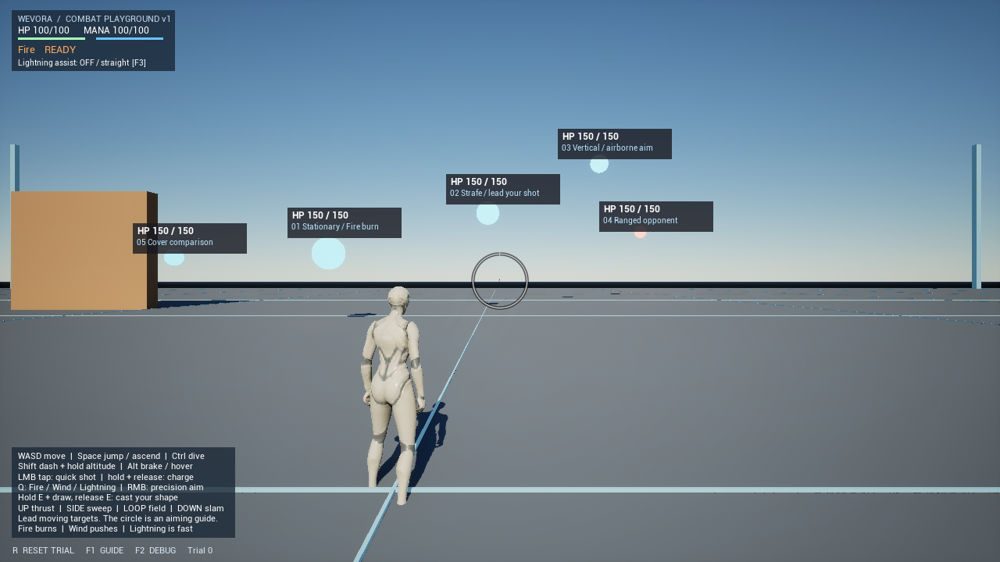

# Combat Playground v1

独立マップ: `/Game/WEVORA/Maps/L_CombatPlayground`。既存の`Lvl_ThirdPerson`と既存Blueprintを保存し直さず、専用プレイヤー／GameModeを複製する。

Draft PR: [#8](https://github.com/Soso2e/WEVORA/pull/8)。人間の操作・バランス評価を待つ。mainへのマージは行わない。

## 主要な判断

- 既存Player BPを複製し4つの設計関数を継承。古い調整値を消さず、試験用倍率はBP解決後の一箇所で適用する。
- 対象は既存Enemyの派生。HP／Reaction／WindのsweepとAI中断・復帰を作り直さず、経路と復活だけを追加する。
- Projectileと汎用Volumeの2系統で4形を表現。属性×形の専用クラスは増やさず、Shape Profilesと対象側Reaction Rulesを組み合わせる。
- Lightning補助は狭い発射時補正・既定OFF。直線弾との比較を残し、ホーミング採用を確定しない。
- 入力→編み→保存BPのSpell Data→共通Cast解決→Delivery→Reaction→Healthの順を維持。Launch/Impact通知とVFXは判定の後。Replicationは追加せず、権威チェックを維持する。
- 単体起動の既定をPlaygroundにし、旧マップもCookする。EditorStartupMapと既存描画設定は維持する。

## Stage A: 反復できるフィールド

- 240m四方の平地、200m四方・高度60mの試験範囲。範囲外は開始位置へ戻り、試験全体を初期化する。
- 静止、横方向、上下方向、既存の浮遊射撃AI、遮蔽比較の5体。HP／燃焼／Windの衝突・AI中断復帰は既存コードを共用。
- `BP_PlaygroundTarget`は`WEVORAEnemy`を継承するC++クラス。死亡後3秒で復活。Rで全体リセット。プレイヤー死亡後2秒で再試行。
- リセットはHP、マナ、チャージ／CT、保持入力、飛行速度、対象の座標・移動位相・燃焼・外力・AI予告／攻撃待ち時間を戻し、弾・破片を除去する。
- 横／縦の移動は増分のsweep。Wind中は経路を一時停止し、その後は押された位置を基準に再開する。自動復活またはRで元の位置へ戻る。

## 保存済み設定の調査

元プレイヤーの巡航1000cm/s、歩行500cm/s、通常攻撃CT0.5秒、チャージ2秒、最大Power2倍。
弾はFire2200／Wind2600／Lightning3200cm/s、半径16cm、寿命4秒。4ShapeすべてProjectile。
Fireは直撃25＋燃焼5/s×3秒、Windは押出900＋Lift220、Lightningは単発25。
保存済みBlueprintの`ResolveSpellLaunch`等4関数のoverrideを維持する。
読み取りスクリプト: `Scripts/inspect_playground_baseline.py`。実測結果: `Saved/CombatPlayground/BlueprintDefaultsBefore.json`。

## アセット作成

`Scripts/create_combat_playground.py`をUE Python commandletで実行する。新規アセットが既に存在する場合は停止し、上書きしない。
既存敵BlueprintのReaction Rules／敵Projectileを新規ターゲットに転記する。
今後の編集は専用Blueprint／マップのDetailsで行う。再生成スクリプトによる既存調整の消去を避ける。

## Stage B: 偏差射撃と円形照準

- 円は目安。中心点から実際のsweep弾を発射する。通常52／RMB28 Slate単位、DPIに追随。外周はCharge／CTを表示する。
- `ResolveCastLaunch`で保存済みBPの解決後にCharge／Playground倍率を適用する。プレビューと実発射は同じスナップショットを使う。
- Playgroundの初期半径倍率1.75、最大Chargeでさらに1.65。Fire/Windの弾速は保存値を維持。距離上限9000cmと既存寿命4秒の早い方で消える。
- Lightningは12000cm/s。F3で発射時だけ1.5度／6000cm以内の補助を比較する。初期OFF。発射後は曲がらず、対象の移動先も予測しない。カメラと発射元双方の遮蔽を確認し、壁越し補助を拒否する。
- F2で実弾道、衝突半径、対象速度を表示。速度継承は専用PlayerのSpellCastComponentでOpt-in、既定OFF。
- 赤表示は射線遮断予告。発射元に障害物があれば発射禁止。途中の壁には弾が衝突する（環境への着弾検証も維持する）。
- 調整箇所: マップ内`Combat Playground - tuning and reset`のShooting／Tuning。発射位置・寿命・速度継承は専用PlayerのSpellCastComponent。

## Stage C: 少数のDeliveryから形を組み立てる

専用PlayerのSpellCastComponent → Shape ProfilesとDelivery Classesで変更する。旧Playerは4ShapeすべてProjectileのまま。

| 入力 | 配送・役割 | 初期仮説 |
|---|---|---|
| LMB短押し／保持解放 | 直線弾、ChargeでPower／半径増加 | Fire2640、Wind3120、Lightning12000cm/s、CT0.5秒 |
| E＋上へ直線 Thrust | 同じ直線Delivery、描いた入力への報酬 | 速度1.4倍、Power1.25倍、手動偏差撃ち |
| E＋左右 Sweep | 一回の横長volume | 前方扇: 長さ1000／左右650／上下200cm、Power0.9、複数対象 |
| E＋円 Circle | 指定方向の短時間Field | 最大1800cm先、半径380、2.4秒、0.6秒毎、Power0.35 |
| E＋下 Slam | 足元より前下方へのArea | 半径420cm、Power1.5、近距離のリターン |

Sweep／Field／Areaは同じ`WEVORASpellVolume`。同一pulse内の重複を排除し、各対象へのLOSを確認する。Fieldはtimer駆動で寿命最大5秒、最小間隔0.1秒。
Field／Slamの中心も手元からのtraceで壁手前へ止める。範囲が壁をまたいでも、壁の向こうの対象は受けない。
属性効果は既存Reaction Rules。Fireの直撃／燃焼、Windの外力とAI復帰、Lightning単発を維持する。感電・連鎖は追加しない。
調整スクリプト`Scripts/configure_playground_spells.py`は専用Playerだけを設定し、既にDelivery Classesが設定済みなら停止する。

## Stage D: 読み取れる戦闘

- Charge: 右手の既存socketに衝突なし核を一つだけ生成・再使用。Chargeでサイズ／光量を補間し、Windは扁平、Lightningは速い脈動。Niagara差替時は核を非表示、`User.ChargeAlpha`を渡す。IdleではTick停止。
- Core/Trail: 既存の属性別InstancedStaticMeshに安定した核を追加。軌跡長は速度×0.07秒（最大1200cm）。当たり判定と独立した見た目。Niagara差替は維持。
- Burst: 既存の材質を引き継ぐ破片＋0.14秒の縮小フラッシュ。対象は属性色・大きめ、環境は灰色・小さめ。Powerでサイズ変化、最大150cm。光源を追加しない。
- Sweepの扇とField/Areaの輪は衝突なし40インスタンスで範囲を表示。判定は別の数値とLOS。
- HUD: 既存ReticleWidget一枚にHP／マナ／属性／Charge・CT／ガイド／リセット／補助状態を追加。F1でガイド、F2でFPS・速度・対象状態・弾道、F3で補助切替。対象頭上にHP・名前・直近ダメージと燃焼。命中markerは実Reaction結果から表示。
- `SpellCastComponent.OnLaunchResolved`／`OnImpactResolved`は実処理後の通知。`OnSpellCast`は従来通り要求で、成功通知ではない。直接ダメージは前後のHealth差。DoTの表示は対象Health通知。
- `CastCount`は成功した配送数、`HitCount`はReaction成立数（Fieldのpulseを含む）。命中率として扱わない。
- 上限: プレイヤーごとDelivery48（最大128に調整可能）、BurstはWorld全体32、破片64/Burst、Field最大5秒／最小0.1秒、Gesture履歴128点。通常弾はDebug OFFでActor Tickなし。既存Desktop／RT無効設定を維持。

## 検証記録

着手前の`WEVORA.`: 23/23成功（`Saved/Automation/PlaygroundBefore/index.json`）。
各Stageと最終ビルドの結果はPROGRESSと最終検証記録へ追記する。NullRHI検証と実描画／実入力の評価を区別する。

最終結果: Editor／Playerコードビルド成功、33/33テスト成功、Blueprint349件コンパイル成功（エラー・警告0）、2マップPackage成功、D3D12/SM6 Player452フレーム・終了コード0。
共有可能なテスト内訳は`CombatPlaygroundAutomationResults.json`、全変更一覧は`CombatPlaygroundFiles.md`。
実入力の確認はWindowsセキュリティ画面で中断。Computer Useの必須操作規則に従い、セキュリティ要求は操作せずユーザーへ依頼した。PIE・飛行射撃の操作感・動的VFX・面白さは未確認。
掲載Screenshotはパッケージ版の初期フレームで、全体reset前のTrial 0。継続プレイやVFXの成功証明として扱わない。

## 調整パラメータ一覧

| 調整対象 | 場所 | 適用タイミング |
|---|---|---|
| フィールド境界／開始位置 | マップのCombat Playground actor: BoundsExtent / MinimumHeight / PlayerStart | 境界は即時、開始位置はR |
| 横／縦の軸・速度・距離・高さ | 各BP_PlaygroundTarget instance: MotionAxis / MotionSpeed / MotionAmplitude、Actor Transform | Detailsで編集してPIE開始。位相はRで再現 |
| 敵HP／速度倍率 | Combat Playground actor: TargetHealth / TargetSpeedMultiplier | R |
| 個別のHP／Reaction／復活待ち | BP_PlaygroundTarget、各instanceのHealth / SpellReaction / RespawnDelay | HPは試験共通TargetHealthがRで優先、Rules／復活待ちは個別値 |
| 敵の射撃・移動・予告 | AI対象instanceの既存AI / Attackカテゴリ | PIE開始 |
| プレイヤー速度 | Combat Playground actor: PlayerSpeedMultiplier | Rで保存済みBPの巡航／歩行へ倍率、ダッシュ加算は既存値 |
| 魔法移動の隙 | 専用PlayerのGetSpellMovementTarget、Cast Recovery等 | 既存BlueprintのWeaving／Shaping／Ready倍率を維持 |
| 弾速／半径／飛距離 | Combat Playground actor: ProjectileSpeedMultiplier / ProjectileRadiusMultiplier / ProjectileRange | 次の照準プレビュー／Cast |
| 属性別の基礎弾速・色・寿命 | BP_PlaygroundPlayer → SpellCastComponent → Element Parameters | 次のCast。Lightning速度は試験LightningSpeedが優先 |
| 発射位置・速度継承 | 同component: SpawnDistance / bInheritShooterVelocity / HorizontalVelocityInheritance | 次のCast、速度継承は既定OFF |
| チャージ時間／CT | actorのChargeTime（Rで適用）、専用Player SpellWeavingのAttackCooldown | R／PIE開始 |
| Chargeの威力・サイズ | SpellCastのMaxChargePowerMultiplier、actorのChargedRadiusMultiplier | 次のCast |
| ダメージ／反応倍率 | actorのDamageMultiplier | 次のCast。既存Powerと同様に燃焼・Windの作用量も倍率適用 |
| 形・配送・範囲・持続・pulse | 専用PlayerのShape Profiles / Delivery Classes | Blueprint Compile / Save後にPIE開始 |
| Lightning比較 | actorのLightningSpeed / bLightningAssist / LightningAssistDegrees / LightningAssistRange | F3またはDetails。既定補助OFF |
| 照準円サイズ | UWEVORAReticleWidgetのTravelRadius / PrecisionRadius | Widget既定値（現状Native生成） |
| VFX・破片・Niagara | 既存ProjectileのAttackEffect、専用PlayerのSelectionEffect、VolumeのAttackEffect | Blueprint / Material / Niagaraの調整 |
| 上限 | SpellCastComponent.MaxActiveDeliveries、Burst上限32はC++ | 各Cast／Impact |

## 人間がPIE／Playerで試す手順

1. `L_CombatPlayground`を開き、World SettingsのGameModeが`BP_PlaygroundGameMode`であることを確認。PIE開始。HP150の**対象**とHP100の**プレイヤー**を区別する。F1でガイドを表示／非表示にできることを確認。
2. WASD→Spaceジャンプ→空中Space上昇、Shift保持／解放、Alt保持／解放、Ctrl降下、無入力落下、地上でマナ回復を順に試す。Yで視点を戻す。Rでマナ／速度／状態／対象位置が戻ることを確認。
3. 静止対象へQでFireを選びLMB短押し。直撃・燃焼・頭上HP・属性色Flash・ヒットmarkerを確認。R後、WindでHPを減らさず押出／浮上、Lightningで高速の単発ダメージを確認。
4. 横移動対象を現在位置に狙って撃ち、次に移動先へ照準をずらして撃つ。距離・半径・速度を一つずつ変更し、Rで同条件に戻す。F2で実弾道と対象速度を確認する。上下対象でも試す。
5. 飛行／ホバー／ダッシュ移動中に同じ試験を繰り返す。RMBで円・FOVが変化し、解除で戻ることを確認。円の周辺に入れただけで自動命中しないことを確認。
6. LMBを1秒／2秒保持して解放。手元核・光量・外周ゲージ・弾サイズ・Powerの変化と0.5秒CTを確認。保持中の移動制限を体験し、通常連打とのリターンを比較。
7. Eだけを保持し、マウスを上／横／円／下に描いてEを解放。Thrustは直線、Sweepは前方扇、Circleは前方の持続領域、Slamは近い前下方の衝撃になることを確認。描画中カメラが固定され、Shift／Ctrlキャンセル後に誤射しないことを確認。
8. 遮蔽レーンで壁を挟み、通常弾・Sweep・Circleに遮蔽が働くことを確認。手元が壁で塞がればMUZZLE BLOCKEDで発射不可、途中の遮蔽はPATH BLOCKEDで環境へ着弾する。壁の縁でカメラだけ通る場合も試す。
9. LightningでF3を切替。中心付近の狭い範囲だけが発射時に補正され、飛行中には曲がらず、範囲外／壁越しには補助が働かないことを確認。補助の好みを記録する。
10. AI対象へ近づいて予告→敵弾→プレイヤーHP低下を確認。Wind中のAI停止→復帰、対象撃破→3秒復活、プレイヤー死亡→2秒後全体再試行を確認。燃焼中・描画中・弾飛行中にもRを押す。
11. 横方向の200m／高度60m境界を越えて全体リセットされることを確認。30／60／120fpsで操作感と読みやすさを比較する。長時間撃ち続けても弾／Field／破片が残留しないことを確認。
12. パッケージ`Saved/CombatPlaygroundPlayer/Windows/WEVORA.exe`でも同じ操作を試す。既定はPlayground。旧マップは起動引数`/Game/ThirdPerson/Lvl_ThirdPerson`で開ける。終了・再起動も確認する。

記録する評価: 飛行中の狙いやすさ、偏差量、通常に対する編み／Chargeの選択理由、属性と形の組み合わせ、被弾の読みやすさ、UIやFlashの邪魔さ、補助OFF/ONの好み。数値は現時点の仮説で、調整済みの完成バランスではない。

## 再実行と既存データ保護

`Scripts/validate_combat_playground.ps1`をリポジトリrootから実行。Editorを閉じて実行する（DLLのリンク競合を避ける）。Editor／33テスト／全Blueprint／Playerコード／2マップCook・Stage・Pak・Archive／15秒のPlayer描画smokeを順に実行する。`-SkipPlayer`で前半だけ実施できる。
Playerのsmokeは実入力や操作感を検証しない。`Saved`内の出力はGit管理外。
既存Content/Config763ファイルの開始時SHA-256を保存。既存Contentは一致。Config2ファイルは意図的にGameDefaultMapとMapsToCookだけ変更し、EditorStartupMap／描画設定／旧マップ内のGameMode・アセットを維持する。

## 残課題

- 人間によるPIEとパッケージの実入力・飛行中の射撃・4Gesture・30/60/120fps体感評価。自動テストや起動成功では代替しない。
- Circle／Slamの配置距離、Sweepの上下幅、Field pulseとFire燃焼refresh、編み／Chargeの報酬値は仮説。プレイ記録から調整する。
- 音・完成Niagara・UIローカライズ・完成アートは未制作。仮メッシュVFXと英語キーガイドを使用し、日本語の詳細手順は本書に記載。
- フィールド境界は警告＋全体reset。競技用の壁や高度制限挙動は将来検討する。
- ネットワーク、部位状態、連鎖／感電、地形反応、製品用メニュー／保存／成長は今回追加しない。
