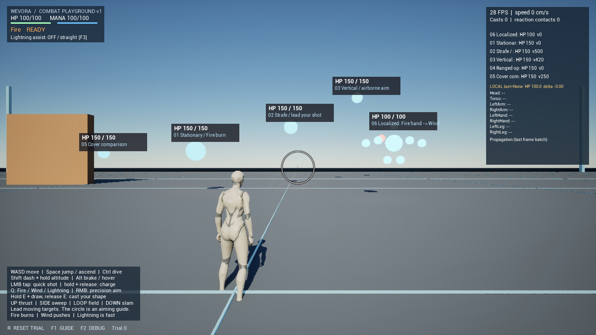

# Localized Elemental Reactions

初期フレーム（Trial 0）の表示確認。reset前の新規対象HPは100、R後は共通設定の150。実入力や延焼中の表示・操作感を確認した画像ではない。

基準: PR #8 `feature/combat-playground` / `6fb59f4`。本ブランチのStacked PRだけで実装する。PR #8は人間の実プレイ検証待ちで変更・マージしない。

## Stage A: 調査とZone

ROADMAP 23〜34、GAME_DESIGNの局所反応、CombatPlayground、Reaction/Health/Delivery/Projectile/Volume/Enemyおよび既存33テストを調査。
既存はReaction Rulesが直撃・全身Burning・Wind外力を確定し、HealthがUnreal標準Damageを受ける。Projectileは一命中、Volumeは対象ごとpulse一命中。AIはWind中休止。PlaygroundはReaction・HP・位置・timerと配送をresetする。

ZoneはFNameのゲームID。標準8Zone以外も追加可能。`UWEVORAZoneProfile` DataAssetでBone/Physics Body/Collider名、位置anchor、隣接グラフを設定する。
Resolver優先順位: 登録Bone → 登録Physics Body → Collider（Bone/BodyのないHitのみ）。存在しないZoneへの設定・未登録Bone・別ActorのComponentはNone。推測で別部位に割り振らない。
正式リグに依存せず、まず仮Colliderを使う。mGear等への移行ではProfileを差し替え、AnchorBoneとOffsetを調整する。

## 責務と互換性の方針

Hit → Resolve → Local Status → Reaction → Health → Presentation。状態とHPの更新はHasAuthorityで制限する。Replicationは実装しない。
Profileを持たない対象は既存全身反応を維持。局所対応対象ではBurningを局所コンポーネントだけが管理する。全身Burningと局所Burningの二重DoTを許可しない。
直撃とWind外力は既存Reaction Rulesを維持する。Lightningの新状態や水属性は追加しない。

同一フレームの局所入力はまとめて確定し、直接付与を反応前に解決する。伝播は共通snapshotを読み、結果をmergeしてから反映する。反応内で新たに生まれた状態を別反応のseedに使わない。
複数Zoneの燃焼DoTは各瞬間で最大強度の一本に集約する（合計しない）。異なる期限は区間積分し、フレーム時間に左右されない。

## Stage B: 状態とHP

`UWEVORALocalizedStatusComponent`を任意Actorに追加しProfileまたはbUsePrototypeProfileを設定する。Health/Reactionは別コンポーネント。
`ApplyStatus / RemoveStatus / HasStatus / GetRemaining / ResetStatuses / AdvanceStatuses`が共通API。`States`は表示用の読み取りsnapshot。
各状態はZone / Type / Element / Intensity / Accumulation / Remaining / DPS / Source / Instigator / AppliedAt / Policyを持つ。
Intensityは無次元、DPSは明示値。状態適用そのものはHPを減らさない。DoTはUnreal標準ApplyDamage経由で既存Healthへ送る。

| Policy | 同じZone・Typeへの再適用 |
|---|---|
| Replace | 新規値で置換 |
| Refresh | 強度・蓄積・DPS・残時間をそれぞれ最大値へ |
| Accumulate | 強度・蓄積・DPSを加算、残時間は最大値 |
| Extend | 残時間を加算、他の値は最大値 |

全PolicyはIntensity10 / Accumulation100 / Duration30秒 / DPS25の既定上限で制限する。Blueprintで調整可能。
複数状態のDoTは**最大DPSの包絡線**を期限で区切って積分する。例: 10DPS×1秒と5DPS×3秒の同時状態は20HP。
30/60/120fpsや4秒のhitchでも同じ総ダメージ。Sourceは最大DPSの状態を使い、同強度はZone/Typeの辞書順で決める。
HealthのOnDeath / OnResetで即時に状態を破棄しTickを停止する。EndPlayでも解放。新しいTimerは使わない。

## Stage C: 伝播と配送

FireのBurning効果は既存Reaction Rulesから取得し、Hitで解決した各Zoneへ適用する。Profile非対応対象は従来の全身Burningのまま。
局所対象は全身Burningを破棄してから処理する。未解決Hitは通常の直撃／Windを維持するが、局所にも全身にもBurningを追加しない。
Reaction.HasState(Burning)は局所状態を集約して返す。旧BurningRemainingは全身状態だけを表し、局所対象では0。

`UWEVORALocalReactionProfile` DataAssetのRulesでTrigger / RequiredStatus / OutputStatus / OutputElementを指定する。
Windは命中Zoneかその隣接ZoneにあるBurningをseedにできる。SeedRadius、EffectRadius、MaxEdgeDistance、MaxPathDistance、MaxHops、最低強度をすべて満たす経路だけを伝播する。
既定はseed半径110cm、作用半径240cm、辺110cm、経路220cm、2hop、最低強度0.1。
強度・DPS・蓄積はseed値×1.15×Wind Power（0〜5）×0.8^hop、残時間はseed残時間×1.3。元Zoneもrefreshする。
単純な全身一括適用はしない。各経路は同じZoneを再訪せず、hop数は実行時にも16以下へ制限する。

直接付与は直ちに可視、局所反応は`TG_PostUpdateWork`の`CommitReactions`でフレーム内入力を一括処理する。
全入力と全Ruleは同じ状態snapshotを読み、Zone/Typeごとの提案を最大値でmergeして一回だけ適用する。新しい出力を同じbatchのseedにしない。
同フレームのFire/Wind呼出順、重複Wind、Rule順による再帰的増幅を防ぐ。直接ダメージ／死亡は従来通り各Hitで確定するため、致死攻撃をまたぐ順序はゲーム上の順序を維持する。
明示的シミュレーションでは全入力後にCommitReactions、次にAdvanceStatusesを呼ぶ。ApplyStatusのReplace/Extend等を別々の操作として呼ぶ順序はAPI呼出者の責務。

Deliveryが対象ごとに一イベント一回を保証する。VolumeはComponentの重複を対象別Hit配列にまとめ、各Zoneに適用しつつ直撃／外力は一回だけ確定する。
Fieldの各pulseは新イベント。同じpulseの重複callbackは無視。Projectileの既存bHitConsumedも維持。判定後にImpactを通知する。
Volumeは各Zoneの位置で形の範囲とLOSを調べる。Actor原点が範囲外でも接触した手が範囲内なら局所的に適用できる。
局所入力は一batch128件まで。状態・経路・入力・DoTは死亡／ResetReactions／ResetHealth／EndPlayで破棄する。
128件を超える場合も到着順で捨てず、Power降順→Zone→Element→命中座標の順に正規化して上位128件を残す。129件を逆順に投入しても同じ結果になることをテストする。
複数Zoneへの直接付与と反応の提案反映はApplyStatusBatchを通し、表示通知はbatch確定後一回だけ発行する。

## Stage D: Playground

既存5対象と保存済みContent/Configを維持し、Combat PlaygroundのBeginPlayで6体目の`WEVORALocalizedPlaygroundTarget`を生成する。
既定位置は(1200,600,300)cm、名前は`06 Localized: Fire hand -> Wind`。bSpawnLocalizedSample / LocalizedSampleTransform / LocalizedSampleClassで変更できる。
既存クラスを汎用基盤の依存先にはしない。新しい対象クラスは仮の表示とColliderを提供するサンプルだけ。

胴体は既存半径45cm Collider、ほか7Zoneは半径22cmのQueryOnly Colliderと衝突なし表示Sphere。表示Sphereは状態に応じ青→橙へ変化する。
局所対象は全身炎VFXを無効にする。旧5対象の全身Fire/Wind/Lightning、既存AI・移動・復活・resetは維持する。
F2はCollider・Zone名・隣接線を表示し、HUDに全8Zoneの状態名/残時間/Intensity/Accumulation、最後のZone、直近HP差、最後の伝播経路を表示する。
HUDは直近命中が局所対象ならその対象、その他は局所サンプルを表示する。世界座標の全Zone表示とLocalStatusesのDetailsにも完全な状態・経路がある。
Debugの切替は衝突設定・範囲・強度・HPの値を変更しない。色・文字・線は戦闘処理を呼ばない。

## 調整パラメータ

| 設定先 | パラメータ | 既定 / 意味 |
|---|---|---|
| Zone Profile DataAsset | Zones / AnchorBone / Offset | 標準8Zone、骨anchor未指定はActor空間cm |
| 同Profile | BoneToZone / BodyToZone / ColliderToZone | 骨格・PhysicsAsset・仮Colliderの対応表 |
| 同Profile | Links / bBidirectional | 標準は手↔腕↔胴、頭・脚↔胴 |
| LocalStatuses | Profile / bUsePrototypeProfile | Profile優先。Profileなし・prototype OFFは局所処理なし |
| LocalStatuses | ReactionProfile | 未指定は標準Fire×Wind Rule。空RulesのDataAsset指定で反応を無効化 |
| LocalStatuses | MaxIntensity / MaxAccumulation | 10 / 100 |
| LocalStatuses | MaxDuration / MaxDamagePerSecond | 30秒 / 25 HP/s、全Zoneの最大値を共有 |
| Reaction Profile Rules | Trigger / RequiredStatus / OutputStatus / OutputElement | Wind / Burning / Burning / Fire |
| 同Rule | MinimumIntensity / SeedRadius | 0.1 / 110cm、命中Zoneか隣接Zoneがseed |
| 同Rule | EffectRadius / MaxEdgeDistance / MaxPathDistance | 240 / 110 / 220cm |
| 同Rule | MaxHops | 2、実行時上限16 |
| 同Rule | IntensityMultiplier / AttenuationPerHop | 1.15 / 0.8。Wind Powerは0〜5に制限して乗算 |
| 同Rule | DurationMultiplier | 1.3、seedの現在残時間に乗算 |
| 対象の既存SpellReaction | Reaction Rules | Fire直撃25、Burning5HP/s×3秒、Wind900+Lift220、Lightning25 |
| 共通Status API | Policy / Intensity / Accumulation / Remaining / DPS | 直接APIならReplace / Refresh / Accumulate / Extendを選べる |
| Playground actor | bSpawnLocalizedSample / Transform / Class | ON / (1200,600,300) / native sample |
| Playground actor | TargetHealth / DamageMultiplier等 | RでHP150へ。従来のCharge/範囲/Power調整も適用 |

調整用DataAssetはContent Browser → Miscellaneous → Data Asset → WEVORAZoneProfile / WEVORALocalReactionProfileから**新規名**で作成し、対象BlueprintのLocalStatusesに割り当てる。
本PRには`/Game/WEVORA/Localized/DA_PrototypeZones`と`DA_FireWindReactions`を新規追加し、6体目のLocalStatusesへ設定済み。Content Browserで直接調整できる。
作成スクリプト`Scripts/create_localized_profiles.py`は既存名があれば上書きせず停止する。通常は再実行不要。
既存Blueprint/Assetを変更する必要はない。サンプルのnative Collider位置はprototype専用で、正式モデルにはそのモデルのPhysicsAssetまたはColliderを設定する。
部位の蓄積は今回表示・蓄積APIまで。閾値発火・耐性・部位破壊などの意味付けは追加しない。

## 人間によるPIE / Player確認

1. `L_CombatPlayground`でPIE開始。既存5対象に加え、開始位置から前方12m・右6m・高さ3mの`06 Localized`を探す。F2で8Zone名と隣接線を表示する。
2. 近づいて静止／ホバーし、QでFireを選ぶ。対象の右手（TorsoからローカルY+150cm、青い外側Sphere）をLMB短押しで撃つ。F2のLast=RightHand、右手だけ橙、他Zoneは`--`、直撃25＋最大5HP/sが見えることを確認する。R後の対象HPは150。
3. 3秒以内にQでWindへ切替。同じ右手、またはRightArmへ当てる。右手→腕→胴の橙色と経路表示、約1.3倍の残時間、同時に押出・浮上が起きることを確認する。
4. 反対側の手にWindを当てた場合や遠いZoneへのWindでは延焼しないことを比較する。届く範囲の意味、隣接ルールの分かりやすさ、期待とのずれを記録する。
5. 放置して全Zoneが青に戻り、HPの継続減少が止まることを確認する。燃焼中・Wind直後・弾飛行中にR。HP・位置・Zone・Last・経路が初期化され、後から延焼／ダメージが出ないことを確認する。
6. 撃破→3秒後復活、プレイヤー死亡→全体再試行、境界外resetを試す。局所対象に旧状態・外力・timerが残らないことを確認する。
7. LMB通常／1秒・2秒Charge、EのThrust / Sweep / Circle / SlamをFire/Wind/Lightningで比較する。範囲攻撃は接触した複数Zoneに状態を付けるが、同pulseの直撃は一回、複数部位DoTは最大DPS一本。Circleの各pulseは別命中になる。
8. 旧5対象と旧ThirdPersonマップで従来Fire全身燃焼、Wind押出・AI中断/復帰、Lightning単発を確認する。F2のON/OFFで命中やHPが変わらないことを比較する。
9. `t.MaxFPS 30 / 60 / 120`で右手の狙いやすさ、大きいCharge弾の隣接部位への接触、表示の重なり・読みやすさ、Wind中の追撃を評価する。最終値は未調整。
10. Packageは`Saved/LocalizedReactionsPlayer/Windows/WEVORA.exe`。旧マップは起動引数`/Game/ThirdPerson/Lvl_ThirdPerson`で比較できる。同じ試験と再起動を実施する。

自動テストは実キーボード／マウスの操作感、正規モデルへの狙いやすさ、面白さの証明にはしない。

## 拡張境界と未実装

- 任意ActorへHealth / SpellReaction / LocalizedStatusを追加できる。プレイヤーでは既存ReceiverのbAffectPlayersを明示的にONにする。プレイヤー全体への標準装備化は今回行わない。
- Zone IDは任意FName。追加モデルはProfileとCollider/PhysicsAssetで対応し、正式Skeleton/mGearモデルでの動作はモデル導入時に検証する。
- 新属性は既存SpellElement側の拡張とReaction Rules、局所Ruleデータで追加する。局所solver自体はWind/Fire専用分岐を持たない。
- 地形・環境Actorにも同じ受信APIを接続可能。今回、他Actor間の伝播・地形状態・水・Lightning状態異常・部位破壊は作らない。
- ホスト側の確定処理へ移せるHasAuthority境界と純粋solverを用意した。Replication、RPC、接続、予測は実装しない。
- 直接ダメージは既存Hitの順序で確定し、局所反応のみフレームbatch。異なるフレームのFire→Windというプレイヤーの順序は維持する。
- 同一状態の複数提案は最大値でmergeする。合算DoTやZoneごとの独立HPは今回の仮仕様に含めない。
- 正式アート、Niagara、アニメーション、音、製品向け表示は未制作。表示は仮Sphere・色・文字。

## 自動テストと再実行

`Scripts/validate_localized_reactions.ps1`をrootから実行する。Editorを閉じて実行。Editorビルド→全WEVORAテスト→旧33件の名前一致→全Blueprint compile→Playerコード→2マップCook/Stage/Pak/Package/Archive→15秒のD3D12 Player smoke→Content/Configハッシュ比較の順。
`-SkipPlayer`はEditor/テスト/Blueprintまで。出力はSaved/Automation/Localized_日時とSaved/Logs/LocalizedFinal*、配布物はSaved/LocalizedReactionsPlayer。既存PR #8の配布物は上書きしない。
NullRHI検証は実移動・衝突と状態を実行するが、実描画や実入力ではない。共有用の最終内訳は[LocalizedElementalAutomationResults.json](LocalizedElementalAutomationResults.json)。

| 新規テスト（WEVORA.Localized） | 検証内容 |
|---|---|
| Resolver | Bone/Collider/未知Bone/無効ID/別Actor/8Zone/隣接 |
| PhysicsAssetHitNormalization | SkeletalMeshComponentのPhysicsAsset BoneName/Body index→Zone。モデルなしの受信Hit正規化 |
| StatusPoliciesAndLifecycle | 局所適用・他Zone隔離・Replace/Refresh/Accumulate/Extend・解除・死亡・Health reset |
| DamageIntegralAndFrameRates | 30/60/120fpsと4秒hitch、最大DPS一本化、期限をまたぐ正確な総量 |
| FireWindCombatLoop | 汎用Actorで手→腕→胴、残時間/強度/DPS、外力、期限切れとreset |
| TopologyDistanceAndCycles | 隣接・seed・強度・辺・経路・作用半径・hop・循環抑止 |
| FrameBatchOrderAndDuplicateDelivery | Fire/Wind逆順、複数Wind共通snapshot、129件上限の逆順、同イベント重複、複数Zone直撃一本 |
| LegacyBurningCompatibility | 全身から局所への移行、二重DoTなし、未登録Hitで誤った全身燃焼なし |
| RealProjectileFireWindAndRespawn | 実sweep弾→右手Collider→隣接腕Wind→胴、同時押出、死亡・復活・全体reset・入力破棄 |
| RealVolumeMultiZoneAndDebugInvariance | 手だけのArea、8Zone Sweep、一回の直撃/最大DoT、F2の判定不変 |
| SavedBlueprintNormalChargeAndAllDeliveries | 保存済みBP、3属性×4Shape×通常/最大Chargeの24組合せで実Delivery・HP・局所状態・Wind反応 |
| RuleOrderAttributionAndInvalidValues | Rule順序、弱いrefreshと複数seed合成での最大DPSのSource保持、不正数値拒否、強度/蓄積/寿命/DPS上限 |

## 最終検証結果（2026-10-17 / Stage E）

| 検証 | 結果 |
|---|---|
| UE 5.8.3 Win64 Development Editor | 成功 |
| 段階別テスト | 着手前33、Stage A34、B36、C40、D42、E45件すべて成功 |
| 最終WEVORA. | **45/45成功**（既存33件そのまま＋新規12件）、未実行/テスト警告/エラー0 |
| 保存済みBlueprint | **349件（/Game 55件）コンパイル成功、警告/エラー0**、保存なし |
| Win64 Development Playerコード | 成功。最終Archive内exeとBinaries版のSHA-256一致 |
| Playground + ThirdPersonのCook/Stage/Pak/Package/Archive | 成功、UAT終了コード0 |
| 最終Package単体起動 | D3D12/SM6、Playgroundロード、452フレーム、終了コード0。F2 HUDと仮Zone対象の初期表示を画像で確認 |
| 既存データ保護 | 既存Content/Config 770ファイルの前後SHA-256一致。新規DataAsset2件を含む772件も一致。最終Cook後は既存Content 765件をbaseのLFS SHA-256と再照合、Config差分なし |
| Git/スクリプト | LFS fsck、diff --check、PowerShell構文検証成功 |

最終テストraw結果: `Saved/Automation/LocalizedFinal/index.json`。共有用は本ディレクトリのJSON。
ログ: `Saved/Logs/LocalizedFinalEditorBuild.log` / `LocalizedFinalAutomation.log` / `LocalizedFinalBlueprints.log` / `LocalizedFinalPlayerBuild.log` / `LocalizedFinalPackage.log` / `LocalizedFinalPlayerRun.log`。
Blueprint検証後の最終修正はsolver内部のDPS Source選択とテストのみ。再度Editor/全45テスト/Player/Packageを実行し、公開APIやBlueprintレイアウト変更はない。

推奨MSVCとの差とEngineヘッダーの非推奨API警告、Cookの既存RigVM EditorDomain循環メッセージ、Playerの既存NVIDIA TSRドライバー警告・初回PSO記録は残る。テスト内の警告やBlueprintコンパイル警告とは区別する。
**人間によるPIE/Playerの実入力、右手の狙いやすさ、動的な延焼の見え方、Wind中の追撃、30/60/120fpsの体感、面白さ、正式Skeleton/mGearでの衝突は未確認。** 数値と最大DPS方針は仮仕様のまま。
